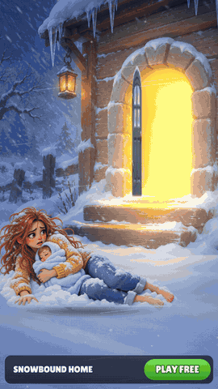
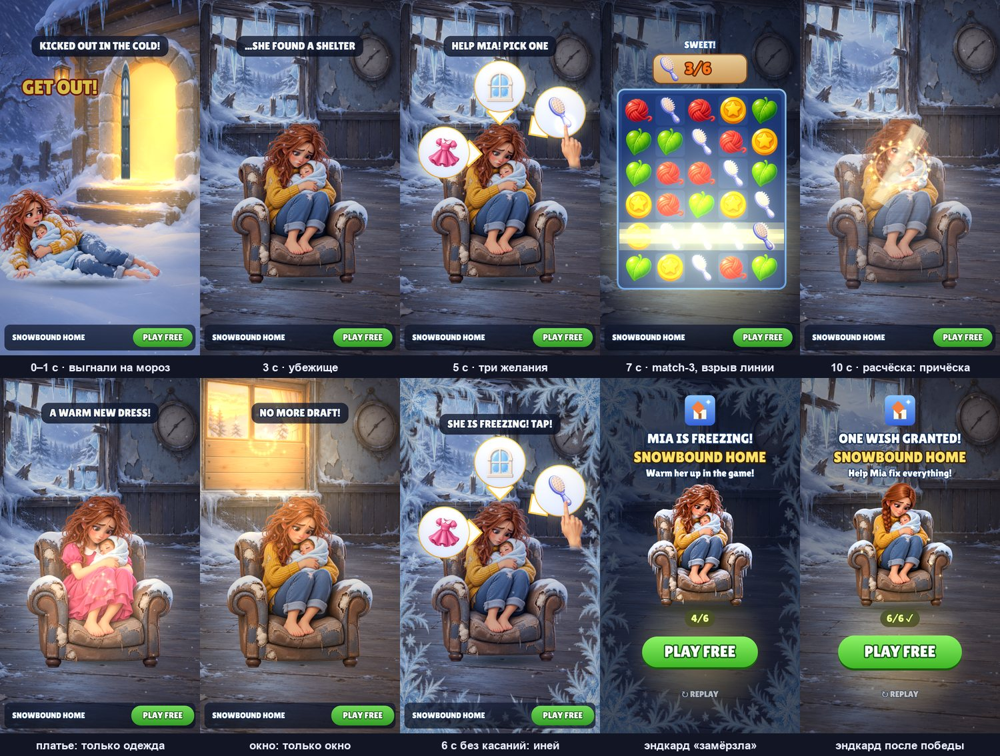

# Snowbound Home — playable ad, собранный ИИ-пайплайном

**▶ Играть в браузере / с телефона:** https://bankaino.github.io/snowbound-home-playable/
(A/B-варианты: [long_goal](https://bankaino.github.io/snowbound-home-playable/long_goal.html) · [pick_dress](https://bankaino.github.io/snowbound-home-playable/pick_dress.html) · [pick_window](https://bankaino.github.io/snowbound-home-playable/pick_window.html) · [sad_end](https://bankaino.github.io/snowbound-home-playable/sad_end.html) · [no_story](https://bankaino.github.io/snowbound-home-playable/no_story.html) · [cta_copy](https://bankaino.github.io/snowbound-home-playable/cta_copy.html) · [auto_pick](https://bankaino.github.io/snowbound-home-playable/auto_pick.html) · [frost_fast](https://bankaino.github.io/snowbound-home-playable/frost_fast.html))

<p align="center"></p>

Портретная playable-реклама истории-пазла в жанре «восстанови дом»: героиню выгнали на мороз, она нашла заброшенное убежище с малышом — игрок выбирает **одно из трёх желаний** (расчёска, платье, окно) и собирает для него три-в-ряд. Сделана **по мотивам рекламного креатива** (история-завязка → выбор желания → match-3 → награда) — со своим брендом, героиней, механикой и артом. Весь путь от референса до билдов под рекламные сети пройден с ИИ-инструментами: **Claude Code** (код, симуляция, агенты-критики), **Codex / ChatGPT image gen** (весь арт), собственные тулзы для сборки и проверки.



## Что внутри за ~16 секунд

| время | бит | что видит игрок |
|---|---|---|
| 0–2.8 с | история | героиня уже лежит на снегу с первого кадра, дверь захлопывается (тряска, свет гаснет), всплывает «GET OUT!», вокруг метель |
| 2.8–4.2 с | убежище | вспышка-склейка: Мия дрожит в рваном кресле с малышом, пар изо рта, снег из разбитого окна. Любое касание пропускает историю |
| 4.2 с | хук | три пузыря-желания, рука указывает на расчёску, «HELP MIA! PICK ONE» |
| 5.5–8.6 с | ядро | поле 5×6: линия из 4+ взрывает ряд (луч, тряска, стоп-кадр 60 мс), собранные плитки летят в счётчик; первая награда ≈ 7 с |
| ~9 с | вау-момент | вихрь звёзд, вспышка, камера наезжает: **выбранное желание меняет только своё** (расчёска — растрёпанные волосы становятся аккуратной косой; платье — только одежда; окно — чинится окно, перестаёт дуть) |
| 10–12 с | зацепка | лёгкая облегчённая улыбка; два невыбранных желания возвращаются **запертыми** — «SHE NEEDS MORE…» (на них можно нажать → стор) |
| 12.4 с+ | эндкард | «ONE WISH GRANTED!», PLAY FREE (весь экран — CTA) |

Принципы из практики плейаблов: история — это крючок, а не ожидание (событие с первого кадра); одно касание; награда ≤ 8 с после первого действия; нет жёсткого проигрыша (проиграл — тоже эндкард); **кнопка стора видна всё время**; на каждое действие — отклик (тряска, частицы, звук, след в мире); рука возвращается после 2.5 с простоя и после двух неверных свайпов.

**Что, если зритель ничего не трогает?** Поле само не играет. Через 6 с без касаний Мия начинает **мёрзнуть**: по краям экрана растёт иней, на ней появляется иней и сосульки, подпись «SHE IS FREEZING! TAP!», ветер громче. Любое касание её отогревает; ещё 6 с тишины — эндкард «MIA IS FREEZING! Warm her up in the game!» (≈ 16.6 с для зрителя, который не трогал экран вовсе). Решение сделано «не пугать»: цвет кожи и лицо не меняются, только иней.

## Билды под рекламные сети — одной командой

```bash
python tools/build_playable.py --variant all
```

Каждый билд — **один HTML-файл** без внешних запросов: движок, код, шрифт, текстуры (WebP в base64) и адаптер сети.

| сеть | размер | лимит | CTA / жизненный цикл |
|---|---|---|---|
| AppLovin | 1.59 MB | 5 MB | MRAID `mraid.open` |
| Unity Ads | 1.59 MB | 5 MB | MRAID |
| ironSource | 1.59 MB | 5 MB | DAPI `openStoreUrl` |
| Mintegral | 1.59 MB | 5 MB | `install()`, `gameReady()`, `gameEnd()` |
| Google Ads | 1.15 MB (zip) | 5 MB | `ExitApi.exit()` |
| Meta | 1.59 MB | 2 MB | `FbPlayableAd.onCTAClick()` |

Звук выключается, когда реклама не видна (MRAID `viewableChange` / DAPI `audioVolumeChange`). До первого касания браузеры не дают играть звуку, поэтому ролик читается и без него (подписи + картинка); где сеть разрешает автозвук, он включается с первого кадра. Полный отчёт: [docs/build-report.md](docs/build-report.md).

## Оптимизация (было → стало)

| что | до | после | как |
|---|---|---|---|
| текстуры | 24 MB PNG | **1.08 MB** | WebP ровно под размер на экране (`tools/build.json`) |
| поле, 30 плиток (покой) | 122 draw calls | **53** | плитки в один instanced draw из атласа (`live/batch.js`) |
| поле, сбор и падение | 173 draw calls | **104** | то же + лимит искр на очистку |
| FPS при замедлении CPU в 4 раза (самый тяжёлый момент) | 53.6 | **58.2** | инстансинг; меньше снежинок под полем |
| FPS на мобильном вьюпорте 390×844 | — | **61** | |
| звук | — | **0 байт** | процедурный WebAudio (`live/audio.js`) |
| шрифт | системный (на Android другой) | **один на всех**, 37 KB | Lilita One (SIL OFL) в base64 |

Экран заполняется на любом телефоне: ширина вида 1080, высота следует соотношению сторон устройства (16:9 … 19.5:9), поле и эндкард подстраиваются по высоте.

## A/B-гипотезы

Вариант = JSON с гипотезой и переопределением параметров (`variants/*.json`), билдится той же командой. Рекомендуемый порядок запуска — по итогам критика:

- `no_story` — без истории (4.2 с), сразу три желания. *Стоит ли история своих секунд до первого касания?*
- `pick_dress` / `pick_window` — рука и автовыбор указывают на платье / окно вместо расчёски. *Какая цель даёт самую сильную награду.*
- `cta_copy` — «SAVE MIA» вместо «PLAY FREE». *Самая дешёвая проверка.*
- `long_goal` — цель 9 вместо 6 (≈ 5.7 хода, победа ~14 с). *Вложенная игра против завершаемости.*
- `frost_fast` — замерзание после 4 с вместо 6. *Больше срочности для сомневающихся.*
- `auto_pick` — контроль: нет замерзания, через 4 с сама выбирается расчёска и зритель видит неигранное поле. *«Увидеть игру» против «увидеть, как Мия мёрзнет».*
- `sad_end` — без лёгкой улыбки в конце. *Что цепляет сильнее: облегчение или невыполненная нужда?*
- `default` — база.

## Как проверяется качество

- **Smoke-тест** (`tools/smoke_test.mjs`): открывает собранный HTML в мобильном вьюпорте с заглушкой MRAID, дожидается выбора, тапает расчёску, свайпает лучшие ходы, тапает CTA; проверяет — нет ошибок, нет внешних запросов, плитки собираются, CTA вызывает `mraid.open`, FPS ≥ 50.
- **Детерминированная симуляция** (`live/sim.js`, 120 Гц): всё — таймерные состояния и события; демо-прогон проверяется headless (`SIM.demoCheck`): все биты рекламы наступают вовремя, пассивный зритель доходит до эндкарда.
- **Игроки-боты** (`tools/player_policies.js`): лучший ход, случайные допустимые, холостой первый ход, медленный, наугад, «тапнул и замер». Итог: все «человеческие» стили выигрывают за 8.5–13 с (30/30), эндкард ≤ 21 с; слепые свайпы — самая слабая когорта (выигрывают ~6 из 30).
- **Профайл** (`tools/perf_probe.mjs`): draw calls и кадры по фазам при замедлении CPU.
- **QA HUD**: 20 экранов интерфейса рендерятся с худшими строками, проверяются выход текста за панель и наложения.
- **Независимые агенты-критики** (3 прохода): оценивали билд против референса и правил рекламы; по их замерам исправлены первый кадр, эндкард, пузыри, слои, тайминги, раскладка под высокие телефоны. Оценки выросли с 5.5 до 7 из 10. Отчёты: [study/critique/](study/critique/).

## ИИ-пайплайн

1. **Разбор референса** → решения: свой бренд и героиня, правило «каждое желание меняет только своё», вместо автоигры — мягкое замерзание для тех, кто не нажимает.
2. **Арт**: style bible + промпт на каждый ассет (`art/prompts/`), генерация пачками через Codex. Все спрайты героини — **правки одного утверждённого спрайта** с условием «меняй только X» (причёска / одежда / лицо / иней), поэтому кресло и поза совпадают до пикселя, а перекрёстное затемнение не мерцает. Края, смягчение и нарезка листов — скриптами. Исходники: `art/gen/`.
3. **Код**: симуляция, сцена, HUD, процедурный звук — Claude Code; живое превью с hot-reload.
4. **Проверка**: smoke-тест, боты, QA, агенты-критики → правки → варианты → билды.

Весь пайплайн — от референса до билдов — пройден **собственными скиллами для Claude Code**.

## Запуск локально

```bash
python -m http.server 8000      # из корня репозитория
# http://localhost:8000/live/index.html?ad=1  — живая версия (рекламный режим)
# http://localhost:8000/live/index.html       — авто-демо (attract), любое касание — играть
python tools/build_playable.py --variant all --pages docs   # билды + демо для GitHub Pages
PLAYWRIGHT=<путь к playwright> node tools/smoke_test.mjs dist/default/applovin.html   # нужен Playwright
node tools/player_policies.js   # боты-игроки
```

## Структура

```
live/        движок (gl.js, lib.js, batch.js), игра (sim.js, scene.js), звук, шрифт, index.html
tools/       build_playable.py, build.json (текстуры, стор), smoke_test.mjs, player_policies.js, perf_probe.mjs
variants/    A/B-гипотезы
art/         style bible, промпты, сгенерированные исходники, правки-вырезки
study/       PLAN.md (решения и журнал фаз), critique/ (отчёты агентов-критиков)
docs/        демо для GitHub Pages, медиа, отчёт по билдам
licenses/    лицензия шрифта (SIL OFL 1.1)
```

## Честно о границах

Ссылки на стор — заглушки (`com.example.snowboundhome`); билды проверены в headless-браузере с заглушкой MRAID, **не** на физическом устройстве и не внутри настоящего SDK сети; звук процедурный и на устройстве не прослушан. Героиня остаётся грустной после исправления — по замыслу (лёгкая улыбка только в самом конце); оценка критика «лучше референса» относилась к четырём его кадрам, а не к полному ролику.

*Референс — чужой рекламный креатив, в репозиторий не включён. Название, бренд, героиня и весь арт — свои; шрифт Lilita One — SIL Open Font License.*
